<p align="center">
  
</p>

<p align="center">
  <a href="https://github.com/Kurtisko221x">
    
  </a>
</p>

<p align="center">
  
  
  
  
</p>


## 🎯 About Me

<table>
<tr>
<td width="55%" valign="top">

```ts
const kurtisko = {
  alias:    "wraith",
  role:     "Vibe Coder & AI Builder",
  location: "Slovakia 🇸🇰",

  building: [
    "AI apps that feel alive",
    "Aesthetic dev tools & CLIs",
    "Creative frontends with motion",
  ],

  learning: [
    "Agentic workflows",
    "Web Audio & shaders",
    "System Design",
  ],

  tech: {
    frontend: ["React", "Next.js", "Tailwind"],
    backend:  ["Node.js", "Express"],
    ai:       ["Claude API", "Structured outputs"],
    tools:    ["Claude Code", "Cursor", "Git"],
  },
};
```

</td>
<td width="45%" valign="top" align="center">
  
</td>
</tr>
</table>

<p align="center">
  
</p>

## 📬 Connect With Me

<p align="center">
  <a href="https://github.com/Kurtisko221x"></a>
  <a href="https://kurtisko221x.github.io/flow-state/"></a>
  <!-- doplň svoje odkazy a odkomentuj:
  <a href="https://instagram.com/TVOJ_NICK"></a>
  <a href="https://discord.gg/TVOJ_INVITE"></a>
  -->
</p>

## 🛠️ Tech Stack

<p align="center">
  
  <br/>
  
</p>

<p align="center">
  
  
  
  
  
  
  
  
</p>

<p align="center">
  
</p>

## 🚀 Featured Projects

<p align="center">
  <a href="https://github.com/Kurtisko221x/aurora-mood"></a>
  <a href="https://github.com/Kurtisko221x/roast-my-vibe"></a>
  <a href="https://github.com/Kurtisko221x/zen-git"></a>
  <a href="https://github.com/Kurtisko221x/aurora-glass"></a>
  <a href="https://github.com/Kurtisko221x/flow-state"></a>
</p>

| | Project | Vibe | Stack |
|:-:|---|---|---|
| 🌌 | **[aurora-mood](https://github.com/Kurtisko221x/aurora-mood)** | Napíš ako sa cítiš → AI namaľuje živú auroru a pustí lo-fi | Next.js · Motion · Claude |
| 🔥 | **[roast-my-vibe](https://github.com/Kurtisko221x/roast-my-vibe)** | Zadaj GitHub nick → AI zroastuje tvoj coder vibe | React · Express · Claude |
| ✿ | **[zen-git](https://github.com/Kurtisko221x/zen-git)** | Git, but make it aesthetic — gradienty, spinnery, štatistiky | TypeScript · chalk · ora |
| 🔮 | **[aurora-glass](https://github.com/Kurtisko221x/aurora-glass)** · [▶ live](https://kurtisko221x.github.io/aurora-glass/) | Vizuálny editor glassmorphism + aurora → CSS/Tailwind/React | React · Tailwind v4 |
| 🌊 | **[flow-state](https://github.com/Kurtisko221x/flow-state)** · [▶ live](https://kurtisko221x.github.io/flow-state/) | Obrie hodiny, jeden task, generatívny lo-fi, emoji konfety | React · Web Audio · Canvas |

## 📊 GitHub Analytics

<p align="center">
  
</p>
<p align="center">
  
  
</p>
<p align="center">
  
  
</p>
<p align="center">
  
  
</p>

## 🏆 GitHub Trophies

<p align="center">
  
</p>

<p align="center">
  <picture>
    <source media="(prefers-color-scheme: dark)" srcset="https://raw.githubusercontent.com/Kurtisko221x/Kurtisko221x/output/snake-dark.svg"/>
    
  </picture>
</p>

<p align="center">
  
</p>
